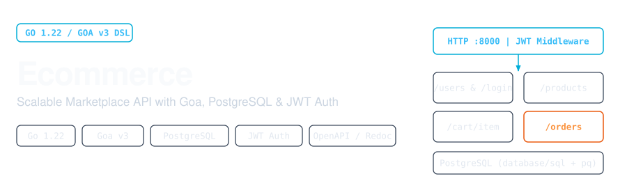
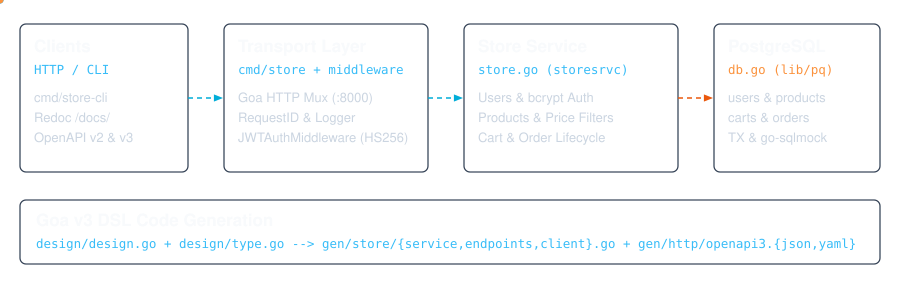

<div align="center">
  
</div>

A scalable online marketplace backend built with **Go (Golang)** and the **Goa v3** DSL framework. Inspired by platforms like HYPD, Etsy, Depop, and Poshmark, it provides user authentication, product listings with price filtering, shopping cart management, and order lifecycle endpoints backed by **PostgreSQL** and **JWT**.

---

## Service Architecture

<div align="center">
  
</div>

---

## Features

- **User Accounts &amp; Authentication**: Registration with `bcrypt` password hashing, login issuing HS256 JWT tokens (`jwthelper`), and protected profile update/delete operations via `JWTAuthMiddleware`.
- **Product Listings &amp; Filtering**: Create and fetch products, list products by `minPrice`, `maxPrice`, or `priceRange`, and query products posted by the authenticated seller.
- **Shopping Cart**: Add items, remove items by `productID`, and retrieve the active cart.
- **Order Management**: Create orders from the current cart, fetch individual or all user orders, delete orders, and update individual order item statuses (`PATCH /orders/{orderID}/items/{productID}`).
- **Contract-First Goa DSL**: API endpoints, payloads, responses, and OpenAPI v2/v3 specs (`gen/http/openapi3.{json,yaml}`) are generated from `design/design.go` and `design/type.go`.
- **Interactive API Docs &amp; CLI**: Built-in Redoc UI (`/docs/`) and a generated CLI client (`cmd/store-cli`).

---

## API Endpoints

Defined in [`design/design.go`](design/design.go) for the `store` service (default host `http://localhost:8000`):

| Domain | Method &amp; Path | Operation |
| :--- | :--- | :--- |
| Users | `POST /users` | Create a new user account |
| Users | `POST /login` | Authenticate user and return JWT token |
| Users | `GET /users` / `GET /users/{id}` | List all users or fetch user by ID |
| Users | `POST /users/update` / `POST /users/delete` | Update or delete authenticated user |
| Users | `GET /users/products` | List products posted by authenticated user |
| Products | `POST /products` | Create product or list products with price filters |
| Products | `GET /products/{id}` | Fetch product details by ID |
| Cart | `GET /cart` | Get current user's cart |
| Cart | `POST /cart/item` / `DELETE /cart/item/{productID}` | Add or remove cart items |
| Orders | `POST /orders` / `GET /orders` | Create order from cart or list user orders |
| Orders | `GET /orders/{id}` / `DELETE /orders/{id}` | Get or delete order by ID |
| Orders | `PATCH /orders/{orderID}/items/{productID}` | Update status of an order item |

---

## Technologies Used

- **Backend**: Go 1.22 (`database/sql`)
- **Framework**: Goa v3 (`goa.design/goa/v3`)
- **Database**: PostgreSQL (`github.com/lib/pq`)
- **Authentication**: JWT (`github.com/golang-jwt/jwt/v5`) &amp; `golang.org/x/crypto/bcrypt`
- **Testing**: `github.com/stretchr/testify` &amp; `github.com/DATA-DOG/go-sqlmock`

---

## Getting Started

### Prerequisites

- Go (v1.20 or higher; `go.mod` targets Go 1.22.5)
- PostgreSQL (local or cloud instance)
- Goa CLI (optional, for regenerating from `design/`):
  ```bash
  go install goa.design/goa/v3/cmd/goa@v3
  ```

### Installation &amp; Running

1. **Clone the repository**:
   ```bash
   git clone https://github.com/prth1234/Ecommerce.git
   cd Ecommerce
   ```

2. **Set up the database**:
   Create a PostgreSQL database and configure your connection settings (for example in `.env` or `config.yaml`, or via the `-db-url` flag):
   ```env
   DB_HOST=localhost
   DB_PORT=5432
   DB_USER=your_db_user
   DB_PASSWORD=your_db_password
   DB_NAME=your_db_name
   ```

3. **Install dependencies**:
   ```bash
   go mod tidy
   ```

4. **Build and run the server**:
   ```bash
   cd cmd/store
   go build
   ./store
   ```
   Optional flags supported by `cmd/store/main.go`:
   - `-host` (default `localhost`)
   - `-http-port` (default `8000`)
   - `-db-url` (PostgreSQL connection URL)
   - `-secure` / `-debug`

   Quick rebuild/restart loop on port `8000`:
   ```bash
   lsof -t -i :8000 | xargs -r kill -9 && go build && ./store
   ```

5. **Access the API**:
   - Server runs at `http://localhost:8000` (use Postman, cURL, or `cmd/store-cli` to interact with endpoints).
   - Redoc documentation is served at `/docs/` with `/openapi.json`.

### Running Tests

```bash
go test ./...
```

---

## Folder Structure

```text
Ecommerce/
├── cmd/
│   ├── store/               # Main HTTP server entry point
│   └── store-cli/           # Generated CLI client
├── design/                  # Goa DSL API & type definitions
├── gen/                     # Goa-generated service, HTTP transport, and OpenAPI specs
├── jwthelper/               # JWT token generation and verification
├── middleware/              # HTTP JWTAuthMiddleware
├── store.go                 # Store service implementation
├── db.go                    # PostgreSQL connection initialization
├── store_test.go            # Unit tests with testify & go-sqlmock
├── go.mod
├── go.sum
└── README.md
```

---

## Contributing

1. Fork the repository.
2. Create a new branch (`git checkout -b feature/YourFeatureName`).
3. Commit your changes (`git commit -m 'Add some feature'`).
4. Push to the branch (`git push origin feature/YourFeatureName`).
5. Open a pull request with appropriate tests.

---

## License

This project is licensed under the MIT License. See the [LICENSE](LICENSE) file for details.

---

## Acknowledgments

- Inspired by platforms like **HYPD**, **Etsy**, **Depop**, and **Poshmark**.
- [Goa Framework Documentation](https://goa.design/)
- [PostgreSQL Documentation](https://www.postgresql.org/docs/)
- [JWT Introduction](https://jwt.io/introduction)

---

## Contact

- **Author**: Parth
- **Email**: dearparthsingh@gmail.com
- **GitHub**: [prth1234](https://github.com/prth1234)
